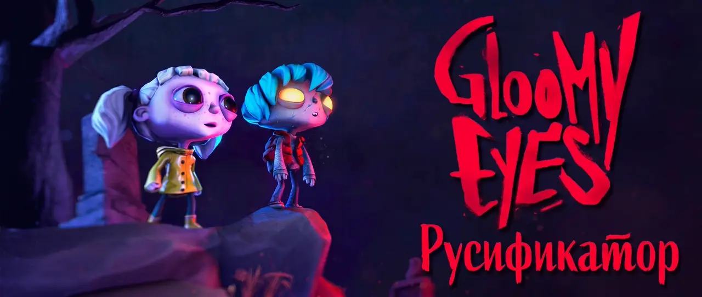
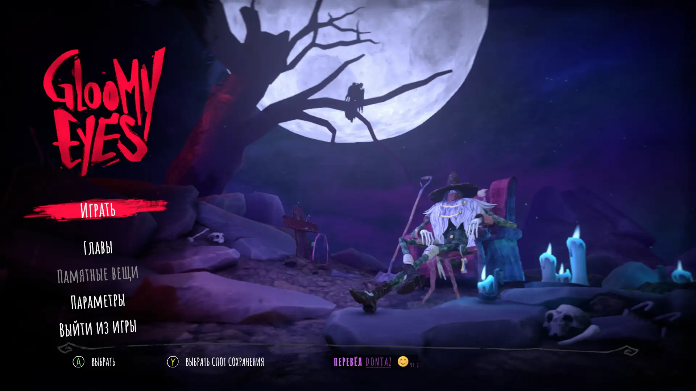
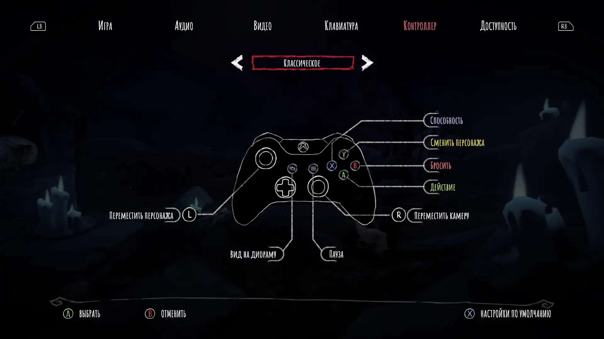
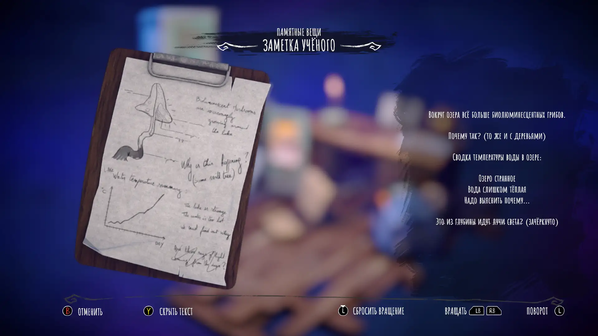
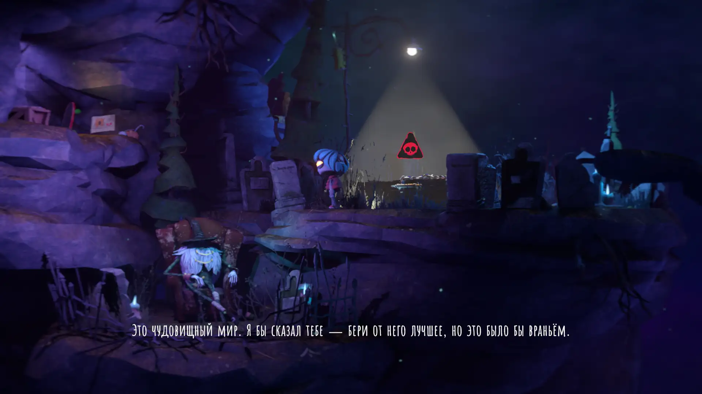

# Русификатор для игры «Gloomy Eyes»

<picture>
	<source srcset="img/banner_anim.avif" type="image/avif">
	
</picture>

 
 

[![MIT License](https://img.shields.io/badge/%D0%9B%D0%B8%D1%86%D0%B5%D0%BD%D0%B7%D0%B8%D1%8F%20-%20MIT%20-%203?style=flat&logo=data%3Aimage%2Fsvg%2Bxml%3Bbase64%2CPD94bWwgdmVyc2lvbj0iMS4wIiBlbmNvZGluZz0iaXNvLTg4NTktMSI%2FPg0KPCFET0NUWVBFIHN2ZyBQVUJMSUMgIi0vL1czQy8vRFREIFNWRyAxLjEvL0VOIiAiaHR0cDovL3d3dy53My5vcmcvR3JhcGhpY3MvU1ZHLzEuMS9EVEQvc3ZnMTEuZHRkIj4NCjxzdmcgZmlsbD0iI0ZGRkZGRiIgaGVpZ2h0PSI4MDBweCIgd2lkdGg9IjgwMHB4IiB2ZXJzaW9uPSIxLjEiIGlkPSJDYXBhXzEiIHhtbG5zPSJodHRwOi8vd3d3LnczLm9yZy8yMDAwL3N2ZyIgeG1sbnM6eGxpbms9Imh0dHA6Ly93d3cudzMub3JnLzE5OTkveGxpbmsiIA0KCSB2aWV3Qm94PSIwIDAgMjI0LjcyNiAyMjQuNzI2IiB4bWw6c3BhY2U9InByZXNlcnZlIj4NCjxwYXRoIGQ9Ik0yMjMuNjEyLDEwOS41ODZMMTkwLjUsMzUuNzUyYy0wLjAwMS0wLjAwMi0wLjAwMi0wLjAwNC0wLjAwMy0wLjAwNmwtMC4wNDMtMC4wOTZjLTAuMTExLTAuMjQ3LTAuMjQzLTAuNDc5LTAuMzg5LTAuNw0KCWMtMC4wMzktMC4wNi0wLjA4Ni0wLjExNC0wLjEyNy0wLjE3MWMtMC4xMzEtMC4xODItMC4yNzItMC4zNTMtMC40MjQtMC41MTRjLTAuMDYtMC4wNjMtMC4xMjEtMC4xMjUtMC4xODQtMC4xODUNCgljLTAuMTY4LTAuMTU5LTAuMzQ1LTAuMzA2LTAuNTMzLTAuNDRjLTAuMDQ5LTAuMDM2LTAuMDk0LTAuMDc2LTAuMTQ1LTAuMTFjLTAuMjM2LTAuMTU2LTAuNDg2LTAuMjktMC43NDYtMC40MDUNCgljLTAuMDc0LTAuMDMzLTAuMTUxLTAuMDU3LTAuMjI3LTAuMDg2Yy0wLjIwNC0wLjA3OC0wLjQxMS0wLjE0My0wLjYyNS0wLjE5NGMtMC4wODgtMC4wMjEtMC4xNzUtMC4wNDItMC4yNjQtMC4wNTgNCgljLTAuMjkzLTAuMDU0LTAuNTkxLTAuMDktMC44OTYtMC4wOWgtNTguNDI4Yy0xLTMuMTExLTIuOTQzLTUuNzk0LTUuNDg1LTcuNzM3di03LjI2MmMwLTIuNzYxLTIuMjM5LTUtNS01aC05LjMzNA0KCWMtMi43NjEsMC01LDIuMjM5LTUsNXY3LjM4MWMtMi40NjUsMS45MzMtNC4zNDcsNC41NzItNS4zMjYsNy42MTlIMzguNzM0Yy0wLjMwNSwwLTAuNjAyLDAuMDM3LTAuODk2LDAuMDkNCgljLTAuMDksMC4wMTYtMC4xNzYsMC4wMzctMC4yNjQsMC4wNThjLTAuMjE0LDAuMDUxLTAuNDIyLDAuMTE2LTAuNjI1LDAuMTk0Yy0wLjA3NiwwLjAyOS0wLjE1MywwLjA1My0wLjIyNywwLjA4Ng0KCWMtMC4yNiwwLjExNS0wLjUxLDAuMjQ4LTAuNzQ2LDAuNDA1Yy0wLjA1MSwwLjAzNC0wLjA5NiwwLjA3NC0wLjE0NSwwLjExYy0wLjE4OCwwLjEzNC0wLjM2NSwwLjI4LTAuNTMzLDAuNDQNCgljLTAuMDY0LDAuMDYtMC4xMjQsMC4xMjItMC4xODUsMC4xODVjLTAuMTUzLDAuMTYxLTAuMjkzLDAuMzMzLTAuNDI0LDAuNTE0Yy0wLjA0MiwwLjA1OC0wLjA4OCwwLjExMi0wLjEyNywwLjE3MQ0KCWMtMC4xNDYsMC4yMjEtMC4yNzgsMC40NTMtMC4zODksMC43bC0wLjA0MywwLjA5NmMtMC4wMDEsMC4wMDItMC4wMDIsMC4wMDQtMC4wMDMsMC4wMDZMMC44OTcsMTA5Ljg0OA0KCUMwLjMzNSwxMTAuNjU3LDAsMTExLjYzNiwwLDExMi42OTZjMCwyMS4zNTgsMTcuMzc2LDM4LjczNCwzOC43MzQsMzguNzM0YzIxLjM1OCwwLDM4LjczNC0xNy4zNzYsMzguNzM0LTM4LjczNA0KCWMwLTEuMDYtMC4zMzQtMi4wMzgtMC44OTctMi44NDdMNDYuNDU2LDQyLjY5Nmg1MC45ODZjMS4wMDcsMi45MDUsMi44MzEsNS40MjQsNS4yMDQsNy4yODZ2MTI1LjM4MUg1OC4zMDgNCgljLTEuODcxLDAtMy41ODYsMS4wNDUtNC40NDQsMi43MDhMNDAuMTEsMjA0LjczOGMtMC43OTksMS41NS0wLjczMywzLjQwNSwwLjE3NCw0Ljg5NGMwLjkwOCwxLjQ4OSwyLjUyNSwyLjM5OCw0LjI3LDIuMzk4aDEzNS41MTkNCgljMC4wMDYtMC4wMDEsMC4wMTIsMCwwLjAyLDBjMi43NjEsMCw1LTIuMjM5LDUtNWMwLTAuOTgtMC4yODItMS44OTQtMC43NjktMi42NjVsLTEzLjU2My0yNi4yOTQNCgljLTAuODU4LTEuNjYzLTIuNTczLTIuNzA4LTQuNDQ0LTIuNzA4SDEyMS45OFY1MC4xMDFjMi40NDktMS44NzMsNC4zMzQtNC40MzYsNS4zNjMtNy40MDVoNTAuODI4bC0zMC40NzUsNjcuOTU0DQoJYy0wLjAwOCwwLjAxOC0wLjAxMiwwLjAzNi0wLjAyLDAuMDU0Yy0wLjAyMywwLjA1NC0wLjA0LDAuMTEtMC4wNjIsMC4xNjVjLTAuMDksMC4yMjktMC4xNjIsMC40NjMtMC4yMTcsMC42OTkNCgljLTAuMDE0LDAuMDYyLTAuMDMyLDAuMTIyLTAuMDQ0LDAuMTg0Yy0wLjA1NSwwLjI4Ny0wLjA4MywwLjU3Ni0wLjA4NywwLjg2NmMwLDAuMDI3LTAuMDA4LDAuMDUxLTAuMDA4LDAuMDc4DQoJYzAsMjEuMzU4LDE3LjM3NiwzOC43MzQsMzguNzM0LDM4LjczNHMzOC43MzQtMTcuMzc2LDM4LjczNC0zOC43MzRDMjI0LjcyNiwxMTEuNTE0LDIyNC4yOTgsMTEwLjQ0MiwyMjMuNjEyLDEwOS41ODZ6DQoJIE02NC42NDYsMTA3LjY5NkgxMi44MjJsMjUuOTEyLTU3Ljc4MUw2NC42NDYsMTA3LjY5NnogTTExOC4yMjYsMzcuNTNjMCwzLjIxNy0yLjYxNyw1LjgzMy01LjgzMyw1LjgzMw0KCWMtMy4yMTcsMC01LjgzNC0yLjYxNy01LjgzNC01LjgzM2MwLTMuMjE3LDIuNjE3LTUuODMzLDUuODM0LTUuODMzQzExNS42MDksMzEuNjk2LDExOC4yMjYsMzQuMzEzLDExOC4yMjYsMzcuNTN6IE0xNTkuOTgsMTA3LjY5Ng0KCWwyNS45MTMtNTcuNzgxbDI1LjkxMiw1Ny43ODFIMTU5Ljk4eiIvPg0KPC9zdmc%2B&labelColor=gray&color=1B6B60
)](https://github.com/Dontaz/GloomyEyes-RU/blob/main/LICENSE) 
 

	

## Содержание

- [Русификатор для игры «Gloomy Eyes»](#русификатор-для-игры-gloomy-eyes)
  - [Содержание](#содержание)
  - [Инструкция по установке через автоматический установщик](#инструкция-по-установке-через-автоматический-установщик)
  - [Инструкция по установке вручную через архив](#инструкция-по-установке-вручную-через-архив)
  - [Инструкция по удалению русификатора](#инструкция-по-удалению-русификатора)
    - [Поставили через автоматический установщик](#поставили-через-автоматический-установщик)
    - [Поставили через архив вручную](#поставили-через-архив-вручную)
  - [Возможные ошибки и их исправления](#возможные-ошибки-и-их-исправления)
  - [Пример перевода](#пример-перевода)
  - [Дисклеймер](#дисклеймер)

## Инструкция по установке через автоматический установщик

> [!IMPORTANT]
> После установки русификатора первый запуск игры может быть дольше обычного (если игра так и не запустилась, а окно консоли зависло, то просто закройте его и снова запустите игру). Не закрывайте консоль (чёрное окно) во время игры. При выходе из игры оно закроется самостоятельно.

1. Скачать файл с расширением «.exe» [отсюда](https://github.com/Dontaz/GloomyEyes-RU/releases/latest) или по кнопке вверху страницы;
2. Запустить «.exe» файл;
3. Нажать «Далее» снизу окна установщика;
4. Проверить, верный ли указан путь к вашей игре. Если путь неверен – указать правильный путь к игре;
5. Когда вы убедились, что путь к вашей игре верен – нажать «Далее» внизу окна установщика;
6. Нажать кнопку «Установить» внизу окна установщика;
7. Установка завершена, нужно нажать «Завершить» внизу окна установщика;
8. Готово, можно запускать игру.

## Инструкция по установке вручную через архив

> [!IMPORTANT]
> После установки русификатора первый запуск игры может быть дольше обычного (если игра так и не запустилась, а окно консоли зависло, то просто закройте его и снова запустите игру). Не закрывайте консоль (чёрное окно) во время игры. При выходе из игры оно закроется самостоятельно.

1. Скачать файл с расширением «.zip» [отсюда](https://github.com/Dontaz/GloomyEyes-RU/releases/latest) или по кнопке вверху страницы;
2. Из архива, который вы скачали, перенесите все файлы и папки в основную папку с игрой (там, где у вас файл «GloomyEyes.exe»);
3. Готово, можно запускать игру.

## Инструкция по удалению русификатора

### Поставили через автоматический установщик

1. Зайти в папку с игрой (в ней находится файл «GloomyEyes.exe», его не удаляйте);
2. Можно удалить вручную, либо через удаление программы:
   - Автоматически:
      1. Зайдите в папку с игрой;
      2. Откройте папку «Удаление русификатора»;
      3. Запустите файл «unins000.exe»;
      4. Готово, русификатор удалён.
   - Вручную:
      1. Зайдите в папку с игрой;
      2. Удалите следующие папки:
         1. «BepInEx»;
         2. «dotnet»;
         3. «Удаление русификатора».
      3. Удалите следующие файлы:
         1. «.doorstop_version»;
         2. «doorstop_config.ini»;
         3. «fontasset»;
         4. «winhttp.dll»;
         5. «Возможные ошибки.txt».
      4. Готово, русификатор удалён.
3. Готово, русификатор удалён.

### Поставили через архив вручную

1. Зайти в папку с игрой (в ней находится файл «GloomyEyes.exe», его не удаляйте);
2. Можно удалить вручную, либо через специальную программу для удаления (она входит в архив с версии 1.1):
   - Автоматически:
      1. Зайдите в папку с игрой;
      2. Запустите программу «Удалить русификатор.exe»;
      3. Готово, русификатор удалён.
   - Вручную:
      1. Зайдите в папку с игрой;
      2. Удалите следующие папки:
         1. «BepInEx»;
         2. «dotnet».
      3. Удалите следующие файлы:
         1. «.doorstop_version»;
         2. «doorstop_config.ini»;
         3. «fontasset»;
         4. «winhttp.dll»;
         5. «Возможные ошибки.txt»;
         6. «ИНСТРУКЦИЯ.txt»;
         7. (если есть) «Удалить русификатор.exe».
3. Готово, русификатор удалён.

## Возможные ошибки и их исправления

1. При первом запуске игры после установки русификатора требуется больше времени, чем при последующих запусках. Это не зависит от того, запускали ли вы игру ранее без русификатора. Это может занять до 5 минут, во время этого процесса игра и/или окно консоли могут один раз перезапуститься. При последующих запусках игры этого происходить не будет (окно консоли всё равно будет появляться, об этом написано в следующем пункте).

2. При открытии игры на фоне всегда будет открываться окно консоли (чёрное окно с текстом). Его нельзя закрывать во время игры, т.к. это закроет саму игру. После выхода из игры окно консоли закроется самостоятельно в автоматическом режиме.

3. Если при запуске игры открылась консоль, но текст не «бежит» в консоли и игра не запускается, то выберите вариант, который совпадает с вашим:

   - Вы уже запускали игру вместе с русификатором и у вас был русский текст в игре, всё работало, но при следующем запуске игры вы видите только консоль и игра не запускается даже спустя ~30 секунд.
      - Решение: закройте консоль и запустите игру повторно, во всех случаях это помогало. Если не помогло, то свяжитесь со мной и опишите проблему, я постараюсь помочь. Писать можете тут: https://forum.zoneofgames.ru/topic/80140-gloomy-eyes или тут https://steamcommunity.com/sharedfiles/filedetails/?id=3834599684 .
	
   - Вы не запускали игру вместе с русификатором, проблема возникла при первом запуске игры вместе с русификатором. Вы видите в окне консоли только красный текст или текст вообще не появляется внутри чёрного окна.
      - Решение: зайдите в папку с игрой, откройте в ней папку «BepInEx». В этой папке, скорее всего, будет отсутствовать папка «unity-libs», что указывает на то, что программа не смогла скачать библиотеки движка Unity, которые нужны для работы русификатора. Сам я эти библиотеки вам дать не могу, поскольку это нарушает лицензию Unity и в таком случае я не смог бы поделиться с вами своим переводом. Варианта решения этой проблемы два: 
        - сначала закройте окно консоли (если оно запущено), затем включите программу для смены виртуальной геолокации и запустите игру повторно, теперь игра должна открываться;
        - сначала закройте окно консоли (если оно запущено), в папке «BepInEx» создайте новую папку и назовите её «unity-libs», скачайте отсюда https://unity.bepinex.dev/libraries/2022.3.59.zip архив и поместите его внутрь папки «unity-libs». Архив не распаковывайте, просто положите внутрь папки, программа-русификатор сама всё сделает.

4. У вас открылась игра и чёрное окно консоли, но в игре текст не на русском. Зайдите в настройки игры и выберите там язык «Русский». Русификатор заменяет английский текст, поэтому скорее всего у вас до этого стоял не английский язык, а к примеру — французский и программа не смогла распознать.

5. У вас игра была на русском, но вы случайно что-то нажали и весь текст теперь на английском. Нажмите сочетание клавишь «ALT + T» (латинская «T», кириллическая «Е») и всё снова будет на русском.

6. У вас всё работает и игра на русском языке, но вы встретили английский текст в ходе прохождения. Причина этому проста: если я лично не увидел этот текст в игре во время своего прохождения, то необходимый текст не появился у меня в файле, который я мог бы перевести. Такая вот особенность игр на Unity и моего способа их переводить. Я постарался пройти игру несколько раз на 100% и тыкнулся в каждый угол карты, чтобы не допустить подобного. Однако, если вы всё же нашли английский текст, то очень вас прошу отправить мне либо сам английский текст, либо скриншот текста, либо описание обстоятельств, при которых появляется этот текст. Я обязательно выпущу обновление, где этот текст будет переведён. Написать мне можно сюда [https://forum.zoneofgames.ru/topic/80140-gloomy-eyes](https://forum.zoneofgames.ru/topic/80140-gloomy-eyes) или сюда [https://steamcommunity.com/sharedfiles/filedetails/?id=3834599684](https://steamcommunity.com/sharedfiles/filedetails/?id=3834599684).

7. Если в пунктах выше не нашлось решения вашей проблемы, то напишите мне сюда [https://forum.zoneofgames.ru/topic/80140-gloomy-eyes](https://forum.zoneofgames.ru/topic/80140-gloomy-eyes) или сюда [https://steamcommunity.com/sharedfiles/filedetails/?id=3834599684](https://steamcommunity.com/sharedfiles/filedetails/?id=3834599684).

8. В крайнем случае, если вам совсем ничего не помогло и вы не можете/хотите описать мне вашу проблему, то могу порекомендовать альтернативный русификатор от других людей, который использует иной механизм перевода текста, который может у вас заработать. Скачать его можете тут: [https://boosty.to/teamrig_true/posts/213e185b-7e04-4c64-92a3-d7841e4952a2](https://boosty.to/teamrig_true/posts/213e185b-7e04-4c64-92a3-d7841e4952a2) или тут [https://www.zoneofgames.ru/games/gloomy_eyes/files/13602.html](https://www.zoneofgames.ru/games/gloomy_eyes/files/13602.html).

## Пример перевода

## Дисклеймер

Данный перевод является неофициальным и фанатским. Он создан исключительно в ознакомительных целях и распространяется бесплатно. Я не преследую коммерческих целей. Все права на игру принадлежат её компании-разработчику и издателю. Если вам понравилась игра, пожалуйста, поддержите разработчиков покупкой лицензионной копии.

Установка, использование или модификация файлов осуществляется пользователем добровольно, по собственной инициативе и под его личную ответственность. Автор перевода не несёт ответственности за возможные последствия, в том числе технические неполадки, некорректную работу программы или утрату данных. Используя данный материал, вы подтверждаете, что принимаете на себя все риски.